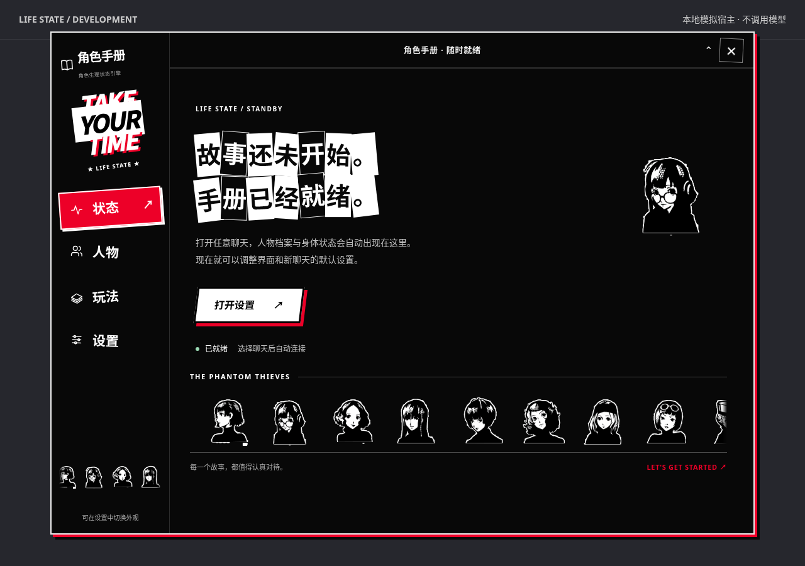
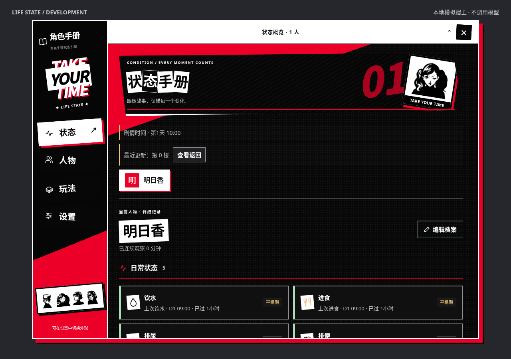
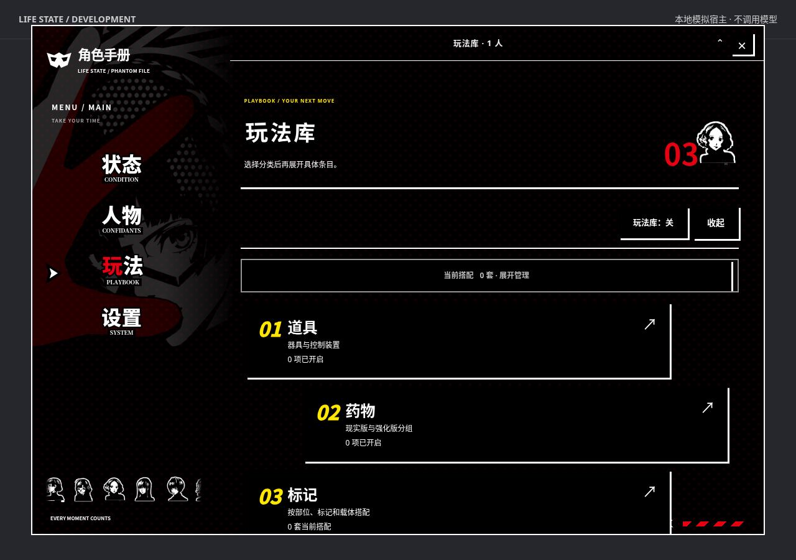
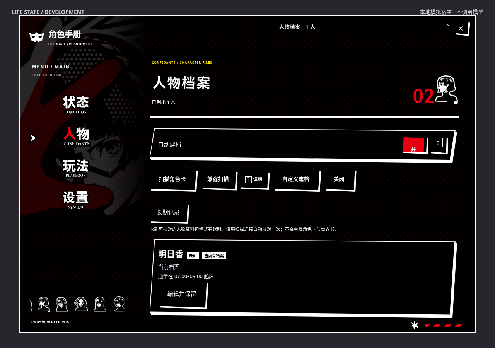
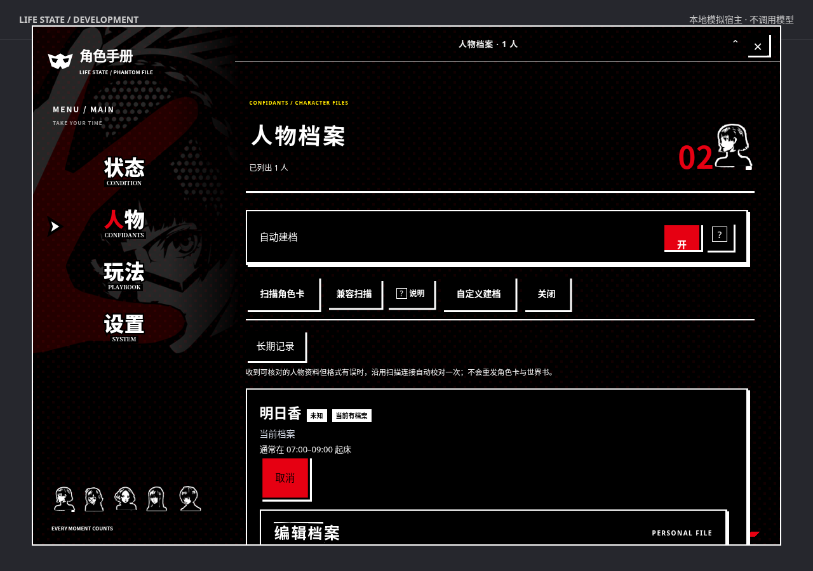
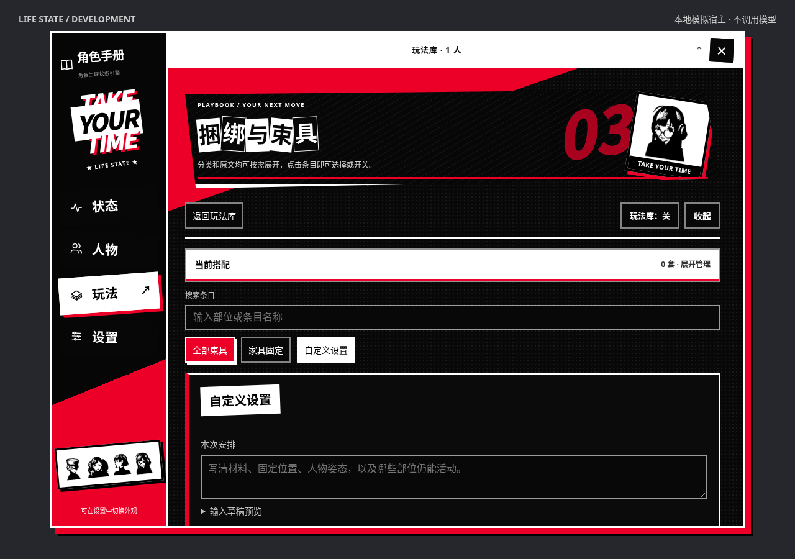
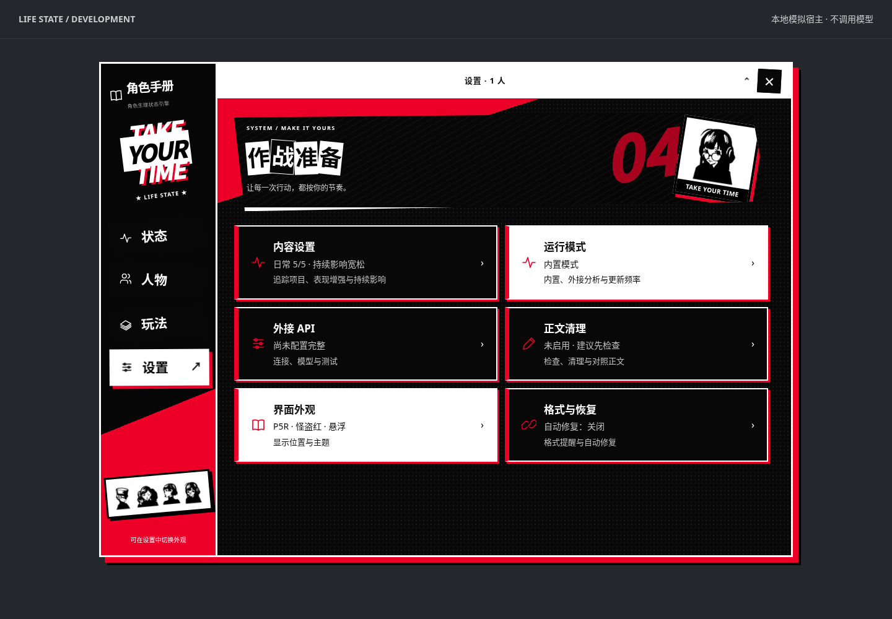
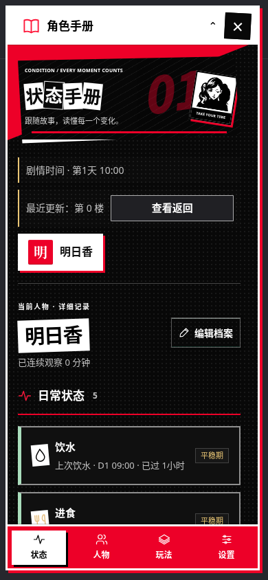

# 角色生理状态引擎 · P5R Edition

基于 [koofer-zia/sillytavern-life-state](https://github.com/koofer-zia/sillytavern-life-state) v5.70 的前端改版，面向 SillyTavern / TauriTavern 原生扩展。角色手册在进入聊天前就准备就绪，以新岛真主题插画、黑白剪纸标题、红色操作反馈和女性 Q 版图标组织界面。

**版本：5.72.2 · 非官方派生版本**

5.72.2 将状态隐藏改为 Markdown 渲染后的隐藏容器，保留格式化结果中的协议文本；状态引擎继续读取聊天原文。“查看返回”显示原文长度和完整状态块数量。沿用 5.72.1 的规整四边形控件、Vertex 扫描参数修正及保存失败重试。

[下载安装包](https://github.com/shirimcclane837-collab/sillytavern-life-state-p5r-public/releases/latest) · [反馈问题](https://github.com/shirimcclane837-collab/sillytavern-life-state-p5r-public/issues) · [原版说明](upstream/README-v5.70.md)



## 本次改进

- **规整按钮**：取消按钮、选中项和按钮文字的倾斜；卡片与弹窗使用直角边界和硬边轮廓。
- **Vertex Gemini 扫描**：取消强制 60000 token，扫描输出上限采用当前设置与 8192 的较小值；Vertex／Google 路径通过提示词输出 JSON 并在本地严格校验。识别 `HTTP 502: Request contains an invalid argument.` 后自动尝试一次兼容请求。兼容模式只清理本次扫描的结构化格式、工具、采样和思考等附加参数，不修改正常聊天预设、连接、区域或凭据。
- **保存反馈与旧对话**：读取存档头即可核对本插件状态，避免为一次更新下载全部聊天与历史候选。短暂读到旧版本时最多重读三次，仍保留聊天身份、分支和状态一致性校验。状态区及“查看返回”同时显示真实保存异常，并提供“重试保存本轮”；该操作不会调用模型。旧版变量迁移保留其他扩展数据，状态块不会写回聊天原文。
- **入口随宿主启动出现**：未选择聊天也能打开欢迎页，提前调整主题、动效和新聊天默认追踪项目。
- **由人物构图组织菜单**：头部与肩背形成向右下延伸的剪影，前臂从左下伸入，菜单排列在连续的白色手掌与前臂上。菜单与插画共用画布坐标，缩放时保持相对位置。中文使用厚重剪贴字，英文保留粗衬线字形，资源随扩展本地安装。内容页使用黑底白字和克制的红色高亮。状态、人物、六类玩法、设置、人物编辑器、应用角色与弹窗均做适配。
- **女性 Q 版图标**：使用参考项目里的黑白图标，装饰入口、菜单、准备页与页头。侧栏与准备页的横条低速循环展示全部 11 位女性角色，悬停或键盘聚焦时暂停，也可使用角落按钮保持暂停。支持拖动、滑动、横向触控板和方向键；关闭动效或启用系统减少动态效果时，仅保留手动浏览。设置里可以切换入口和准备页的小图标，不改动聊天人物头像，也不替换主插画。
- **分层动效**：细白刀光、标题短促落位和选择指针区分导航层级，正文与表单的点击位置保持稳定。前进与返回方向相反；输入、勾选和数据刷新不重播导航。连续点击取消过期动画，收起后清理临时裁切，避免再次展开时挡住入口。支持关闭动效和系统减少动态效果设置。详见[动效设计与参考](docs/motion.md)。
- **正则兼容修复**：有宿主格式化接口时，先完整运行用户正则，再隐藏残留的 `life_state`、`state_handoff`、`story_time`。不改聊天原文、提示词或用户正则顺序；用户正则生成的自定义面板可正常保留。只迁移匹配旧插件特征的隐藏规则，用户修改过的转换保留。旧宿主采用保守的 DOM 尾部识别；不能可靠辨认时保留显示。详见[机制与兼容边界](docs/regex-compatibility.md)。
- **保留操作上下文**：各页保留滚动位置，编辑草稿与输入焦点在刷新时恢复。转场中的表单保持固定点击位置。
- **桌面窗口拖动**：按住顶部标题栏文字或空白处移动，关闭与设置按钮保留点击功能。拖动不会误触收起；入口与展开窗口分别保存位置，刷新后恢复，调整浏览器大小时限制在可见范围内。
- **手机适配**：准备页保留手掌上的菜单，内容页使用底部导航、单列内容和独立滚动，兼顾横屏与小屏。
- **界面与聊天分别管理**：切换聊天立即清理旧人物展示，显示读取中或失败重试；退出聊天仍保留入口，停用扩展时释放窗口、事件和动画。

原有状态计算、人物档案、聊天存储格式和三种分析方式沿用上游实现。本次改动涉及前端展示、人物扫描请求、状态块显示与保存核对。旧「墨青」「晴白」设置自动映射到 P5R，仍保留暮紫与原版布局选项。

## 安装

先停用旧原生扩展或酒馆助手脚本并刷新，再安装本版；同一时间只运行一份。切换前建议备份聊天和设置。

在酒馆的「扩展 → 安装扩展」中粘贴：

```text
https://github.com/shirimcclane837-collab/sillytavern-life-state-p5r-public
```

安装后启用并刷新，未进入聊天也应看到悬浮入口。已有聊天继续使用原来的状态记录与设置。

也可以从 [Releases](https://github.com/shirimcclane837-collab/sillytavern-life-state-p5r-public/releases) 下载 `sillytavern-life-state-p5r-5.72.2.zip`，将其中的整个扩展文件夹放进宿主的第三方扩展目录，再刷新并启用。SillyTavern 常见目录为 `data/<用户>/extensions/`；TauriTavern 的实际目录由应用数据位置决定，优先使用应用内的扩展管理器。

**本版提供原生扩展，不提供酒馆助手 JSON 导入文件。** GitHub 自动生成的 Source code 也不是助手脚本。

## 使用

1. 未选择聊天时，打开手册的「设置」，调整主题、动效、Q 版装饰图标和新聊天默认追踪项目。
2. 进入聊天后，在「设置 → 内容设置」调整当前聊天的追踪范围；已有聊天不会被新默认设置覆盖。
3. 在「人物」页扫描或手动建立档案，也可以开启自动建档。
4. 在「状态」页查看角色状态，在「玩法」页选择分类、编辑搭配并选择应用角色。
5. 在「设置 → 运行模式」选择内置、外接协作或外接独立分析；外接模型使用原有 API 设置流程。

「设置 → 界面外观」可以切换主题、图标、动效、入口大小，以及悬浮或正文下显示。点击关闭按钮或按 Escape 收起手册。按住入口可拖动；电脑上展开后，按住顶部标题栏的文字或空白处可移动窗口。两种状态的位置分别保存，拖动时会限制在屏幕范围内。

侧栏与准备页的头像横条会自动缓慢滚动。鼠标移入或键盘聚焦时暂停，离开后继续；可直接左右拖动或滑动，也可按左右方向键逐个浏览。角落的暂停按钮可保持暂停。「界面动效」同时控制页面转场和头像自动滚动；关闭后仍可手动浏览。手机在头像上上下滑动仍可滚动页面。

更新时使用扩展管理器更新并刷新。手动安装时替换整个扩展文件夹，避免混用不同版本的入口、运行文件和样式。停用扩展不会清除聊天记录。

## 预览

截图使用本仓库的浏览器模拟宿主和示例人物，不包含真实聊天，也不调用模型。

[桌面交互录屏](https://github.com/shirimcclane837-collab/sillytavern-life-state-p5r-public/releases/download/v5.72.1/motion-desktop.mp4) · [手机交互录屏](https://github.com/shirimcclane837-collab/sillytavern-life-state-p5r-public/releases/download/v5.72.1/motion-mobile.mp4) · [手机准备页](docs/screenshots/welcome-mobile.png) · [手机人物编辑器](docs/screenshots/mobile-editor.png)





| 人物档案 | 人物编辑器 |
| --- | --- |
|  |  |

| 玩法详情与应用角色 | 设置 |
| --- | --- |
|  |  |



## 开发与验证

安装扩展无需 Node.js 或构建。开发环境建议使用 Node.js 20+：

```sh
npm ci
npx playwright install chromium
npm run build:ui
npm run check
npm test
npm run preview
```

预览默认在 `http://127.0.0.1:4173`，是无模型调用的模拟宿主。测试也使用该模拟宿主；已有系统 Chromium 时可运行 `CHROMIUM_PATH=/usr/bin/chromium npm test`。

| 文件 | 职责 |
| --- | --- |
| `index.js` | 原生扩展启停与宿主就绪事件 |
| `src/runtime.js` | 原有引擎、聊天适配、数据与界面编排 |
| `src/profile-scan.js` | 扫描请求与单次兼容参数隔离 |
| `src/chat-persistence.js` | 流式读取聊天元数据头 |
| `src/output-visibility.js` | Markdown 后的保留文本隐藏、旧规则迁移与旧宿主 DOM 处理 |
| `src/ui/view.js` | 空状态、转场、动效偏好、滚动位置与窗口行为 |
| `src/ui/react/menu.jsx` | React 菜单、准备页、RansomText、SVG 与 Motion 场景 |
| `src/ui/layers.js` | 为原有真实控件添加三层外观，保留表单和事件 |
| `src/ui/royal.css` / `src/ui/queen.css` | 几何组件、阅读布局与新岛真插画构图 |
| `src/ui/generated/` | 已打包的 React、Motion 与隔离的 Tailwind 工具样式 |
| `src/ui/art.js` | 女性 Q 版图标、拼贴标题、主题装饰 |
| `src/ui/party-reels.js` | 头像循环滚动、手动浏览、暂停偏好与生命周期 |
| `src/ui/p5r.css` | 样式入口，加载基础布局与完整组件适配 |
| `src/ui/assets/` | 黑白图标与来源说明 |
| `tests/frontend.spec.js` | 浏览器交互与生命周期回归测试 |
| `tests/dragging.spec.js` | 桌面拖动、位置恢复、边界与触摸入口回归测试 |
| `tests/party-reels.spec.js` | 头像循环衔接、鼠标键盘与触摸、暂停和启停回归测试 |
| `tests/output-visibility.spec.js` | 正则迁移、整段替换、自定义面板、编辑、启停和旧宿主显示回归 |
| `tests/profile-scan.spec.js` | Vertex 参数、502 重试与其他请求隔离 |
| `tests/state-saving.spec.js` | 旧存档、状态保存、长聊天、延迟读取与失败重试 |
| `tests/fixtures/` | 模拟宿主、示例状态和本地 API 桩 |
| `scripts/build-ui.mjs` / `scripts/build.mjs` | 前端打包、可安装目录和 SHA-256 文件清单 |
| `upstream/` | 原版 README 与 v5.70 签名档案 |

修改 React 或 Tailwind 源文件后运行 `npm run build:ui`，并提交生成文件。修改受完整性检查保护的运行函数后，先审查修改，再执行 `npm run integrity` 更新**派生版本**的函数指纹，随后运行 `npm run check` 与 `npm test`。`npm run build` 会重新打包前端，将安装文件和 `checksums.json` 输出到 `release/sillytavern-life-state-p5r-5.72.2/`。

49 项回归测试覆盖无聊天启动、默认设置、聊天切换、启停、输入草稿和焦点、快速导航、动画中断、减少动效、旧异步操作失效、失败重试、弹窗保存、图标持久化、人物编辑保存、六个玩法分类与应用角色，以及桌面和三种小屏尺寸。还覆盖桌面拖动、独立位置恢复、屏幕边缘与窗口缩放，以及头像横条的循环衔接、暂停、拖动、横向滚轮、键盘浏览和启停。正则测试使用模拟宿主注册表、实际 Showdown 与 DOMPurify，覆盖原文和隐藏文本保留、用户面板、旧规则迁移、转义标签及旧宿主显示。状态块独占整条回复时，还验证隐藏后的消息事件处理、保存、聊天重载，以及空白新分支不会误读旧内容。另覆盖 Vertex 请求参数、502 兼容重试、临时钩子清理、旧版变量迁移、阶段型状态块保存、存档头流式读取、延迟读取、切换聊天保护和保存失败后的重试。手机手势使用 Chromium 原生触摸事件模拟，未做真机验证。

适配基线沿用上游的 SillyTavern 1.18.0 原生接口，并核对了 TauriTavern 扩展加载接口。**本次验证未包含真实模型调用，也未完成 TauriTavern 原生桌面应用端到端运行**；这些场景需要在实际宿主中验证；Vertex 请求的参数回归使用模拟接口，未连接真实 GCP 账号。

## 来源与署名

原作者：**koofer（类脑社区）／[koofer-zia](https://github.com/koofer-zia)**。基于上游提交 `31b518b`（v5.70），保留原作者署名、水印、原版说明及签名档案。

原作者发布声明：**「请保留作者署名；未经作者许可，请勿修改后重新发布。」** 派生版本标识不代表原作者对本版的授权或背书，也不增加上游未授予的许可。

P5R 前端改版维护：[shirimcclane837-collab](https://github.com/shirimcclane837-collab)。视觉和黑白图标参考 [q-mona/p5-ui](https://github.com/q-mona/p5-ui) 及其 [文档](https://p5ui.morna.cn/)。图标由原项目的内嵌 PNG 原样提取，详见 [素材来源](src/ui/assets/NOTICE.md)。Persona 5 / Persona 5 Royal 相关美术属于原权利人 ATLUS / SEGA。

新岛真主插画按用户提供的游戏截图通过 GPT-Image 生成，属于主题参考与衍生插画，不是原游戏素材。手套为同一只手套的红白分色，图片不带菜单文字或控制器提示。详见[素材来源](src/ui/assets/NOTICE.md)。

菜单展示层使用 React + Tailwind CSS + Framer Motion，原有表单和数据引擎继续保留。依赖和图片随扩展本地打包，不请求 CDN、远程字体或外部图片。组件依赖许可见 [THIRD_PARTY_NOTICES.md](THIRD_PARTY_NOTICES.md)。本项目与原游戏及参考项目无关联或背书关系。

`upstream/signature-v5.70.json` 仅为原版签名存档，**不能验证本版**。本版采用独立的派生构建完整性标识与安装包 SHA-256 清单，不冒充上游官方签名。
